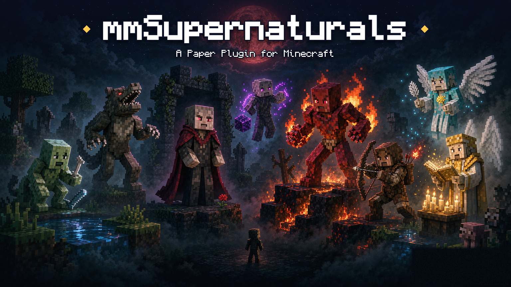

# mmSupernaturals



A Paper plugin that adds eight supernatural races to Minecraft — Vampire, Ghoul, Werewolf,
Demon, Priest, WitchHunter, Angel and EnderBorn — each with its own abilities, its own way of
turning people, and its own counters. A player is an ordinary person until something turns them.

Java 25 · Paper 26.3 (`api-version: 26.3`) · GPL-3.0

---

## About this repository — read this first

**This plugin is not published by its original author.** It is a community fork, kept alive by a
player on top of a fork that was already drifting around the internet. Nobody who wrote the
original is involved, and nothing here carries their endorsement.

mmSupernaturals descends from *Supernatural Players*, a Bukkit plugin first published in 2011 under
the handle **Matterz**. That project no longer exists as anything maintained: its source repository
(`github.com/Matterz/SupernaturalPlayers`), the account that held it, and its dev.bukkit.org page
all answer 404 today. What is left of it are forks, and this is one of them.

I played on servers that ran this plugin and liked it. When I went looking for it years later all I
could find were stale copies, so I took one up and have been keeping it working on modern Paper.

### The lineage, and how it was checked

| When | What it is |
|---|---|
| 2011 | *Supernatural Players* v2.5.2 by **Matterz** — the original; repository and author account both gone |
| 2011–2012 | A continuation of it — commits by **Connor Anderson**; that repository is gone too, and its history survives only inside the next row |
| 2025 | [FaeyUmbrea/mmSupernaturals](https://github.com/FaeyUmbrea/mmSupernaturals) — an archived re-upload of that continuation |
| 2026– | This repository — a GitHub fork of the archived one |

The checks behind that table, all re-run on 2026-10-24:

- GitHub's API reports this repository as `fork: true`, with `parent` and `source` both
  `FaeyUmbrea/mmSupernaturals`.
- That repository is `archived: true` (last push 2025-04-09), was uploaded rather than forked
  (`fork: false`), and says in its own description: "THIS IS A FORK, I AM NOT THE DEVELOPER OF THIS
  BUKKIT PLUGIN. mmSupernaturals- A bukkit plugin based off of Matterz's Supernatural Players".
- The root commit of this history (`602e8bd`, 2011-12-17) carries a `plugin.yml` reading
  `name: SupernaturalPlayers`, `version: 2.5.2`, `author: Matterz`, and a README that calls the
  project a continuation of Matterz's plugin. The code in that commit is the code this fork still
  builds.
- `github.com/Matterz/SupernaturalPlayers`, `github.com/Matterz` and
  `dev.bukkit.org/projects/supernatural-players` all return 404. (There is a live
  `dev.bukkit.org/projects/supernaturals` page, but it is a different project — it does not mention
  Matterz or *Supernatural Players*, so it is not counted as evidence here.)

Two things could not be checked, and are not claimed. Matterz's real name: only the handle survives,
and an earlier revision of this page expanded it to a full name that cannot be substantiated, so it
is the handle only now. And whether the 2011–2012 committer "Connor Anderson" is the same person as
**mmiillkkaa**, who is credited on the Bukkit continuation thread and in `plugin.yml`.

What that means for you:

- **Not official, not endorsed.** There is no original author's repository left to be official
  against, and nothing here has their blessing.
- **Support stops here.** Bugs in this build are this fork's, not the original authors'. Please
  report them in this repository's issues rather than to Matterz or mmiillkkaa.
- **Maintained by one person in his spare time** ([VampireAchao](https://github.com/VampireAchao)).
  Issues and pull requests are welcome; there is no schedule and no warranty.
- **Licence inherited, not relicensed.** The 2011–2012 continuation carried GPL-3.0
  (`gpl-3.0.txt` is in this repository's history); this fork keeps it.

### What has happened since the fork

- The 2012 Eclipse project was migrated to a Maven build — `mvn package` produces the plugin jar.
- The build was retargeted at modern Paper: Paper API 26.3, Java 25, `api-version: 26.3`.
- A test harness was added: unit tests, plus scenario tests that boot a real Paper server and
  drive fake players through a hall of test rooms (`mvn verify -Pit`).
- A series of gameplay bugs were fixed along the way. Among them: the plugin's clock advanced
  once per player instead of once per tick, so every timed rule ran faster the more people were
  online (fixed in 1.4.1).
- The first published build,
  [1.4.1](https://github.com/VampireAchao/mmSupernaturals/releases/tag/v1.4.1), is on the
  Releases page.

## Installing

1. Download `mmSupernaturals-1.5.1.jar` from the
   [Releases](https://github.com/VampireAchao/mmSupernaturals/releases) page.
2. Drop it into your server's `plugins/` directory.
3. You need **Paper 26.3** and **Java 25**. WorldGuard is an optional soft dependency; a
   permissions plugin is recommended.
4. The plugin writes its own `config.yml` on first start. No command is needed to begin
   playing — a player is an ordinary person until something turns them.

## The races

- **Human** — the default state. Everyone starts as one, and every race below is a way out of it.
- **Vampire** — turned by an altar built of gold; burns in daylight unless protected; builds a
  lapis altar to become human again.
- **Ghoul** — the undead, made by pig zombies; takes damage from water unless protected; the
  Church's altar can cleanse one back to humanity.
- **Werewolf** — humans who die to wild wolves at night may turn; brews a Wolfbane potion to
  turn back.
- **Demon** — walked into the Nether in leather armor and surrendered to the Inferno; dies in
  icy water while carrying snowballs to cool the demonic fire.
- **Priest** — earned by devotion to the Church; leaves by insulting it with coal on the
  donations altar.
- **WitchHunter** — invited after slaying three different kinds of supernatural without dying;
  carries a kill list that is regenerated on server start; removed from the Association by
  killing themselves (poor bow skills).
- **Angel** — summons animals with food offerings: a cow with beef, a wolf with a bone, a pig
  with a porkchop.
- **EnderBorn** — turns the players it kills, at a configurable chance
  (`EnderBorn.Convert.Chance`).

All classes have abilities that depend on their power level, and gain power in their own way.

## Joining and leaving a class

Joining:

- Humans construct special altars to convert to **Vampires**, starting with a solid gold block.
- Humans sometimes convert to **Werewolves** when dying to wild wolves at night.
- Pig zombies sometimes have the ability to make humans undead — **Ghouls** — rather than just
  dead.
- Any human who shows proper devotion to the Church may become a **Priest**.
- Non-priest humans who can prove their supernatural hunting abilities by slaying 3 different
  types of supernaturals without dying will be invited to the **WitchHunters'** Association.
- Humans who enter the Nether covered in dead animal skins (leather armor) and sacrifice
  themselves to the Inferno will become **Demons**.

Leaving:

- **Vampires** construct special altars to regain their humanity, starting with a solid lapis
  block.
- **Werewolves** must make themselves a Wolfbane potion, starting with an empty bowl.
- **Priests** merely have to insult the Church by offering coal to the donations altar.
- The holy energy of the Church's altar will sometimes cleanse a **Ghoul** and restore their
  humanity.
- **Demons** who die in icy water while carrying snowballs will find the demonic fire in their
  blood cooled.
- **WitchHunters** who exhibit extremely poor bow skills (kill themselves) will be removed from
  the Association.

Angel and EnderBorn have their own paths in as well — run `/sn classes` in game for the short
version of each.

## Commands

`<required parameter>` · `[optional parameter]`

Player commands:

- `/sn help` — shows a list of available commands
- `/sn power` — shows your current class and power level
- `/sn list` — shows a list of online players in each class
- `/sn classes` — shows a list of classes with a short description of each
- `/sn killlist` — shows the WitchHunter kill list
- `/sn join` — opts you in to the plugin (only used when `enableJoinCommand` is on; otherwise
  everyone is in automatically)

Admin commands:

- `/sn admin` — shows a list of available admin commands
- `/sn cure <playername>` — restores a player to humanity (reverting them to priest or making
  them human)
- `/sn convert <playername> [class]` — converts a player to the specified class
- `/sn power <playername> [amount]` — gives a player the specified amount of power
- `/sn reset <playername>` — resets a player's power to zero
- `/sn rmTarget <playername>` — removes a player from the WitchHunter kill list
- `/sn reload <type>` — reloads the `config.yml` or `data.yml` file
- `/sn save` — saves both `config.yml` and `data.yml`
- `/sn restartTask` — restarts the task timer used for many passive abilities (in case it
  crashes due to overload)
- `/sn setChurch` — sets your current location as the Church
- `/sn church <add|remove|list|clear>` — manages the churches an altar can belong to (there can
  be more than one)
- `/sn setBanish` — sets your current location as the banish location

## Permissions

`plugin.yml` is the authoritative list. The classic set:

- `supernatural.command.help` / `.list` / `.power` / `.classes` / `.killlist` — access to the
  matching player commands (default: true)
- `supernatural.player.shrineuse.vampire` / `.priest` — access to vampire and priest shrines
  (default: true)
- `supernatural.player.wolfbane` — wolfbane potion creation (default: true)
- `supernatural.player.preventwaterdamage` — prevents ghouls from taking water damage
  (default: false)
- `supernatural.player.preventsundamage` — prevents vampires from taking damage in sunlight
  (default: false)
- `supernatural.player.witchhuntersign` — allows a player to create WitchHunter signs used for
  WitchHunter halls (default: true)
- `supernatural.admin.infinitepower` — unlimited power (default: op)
- `supernatural.admin.partial.curse` — change your own class only (default: op)
- `supernatural.world.enabled` — per-world toggle for whether supernatural rules apply
  (default: true; used with multiworld)
- `supernatural.admin.command.*` — one node per admin command (default: op)

Wildcards: `supernatural.*` gives everything; `supernatural.command.*`,
`supernatural.player.*` and `supernatural.admin.*` give their groups.

## Setting up

1. Download the plugin (or build it — see below) and place it in your `plugins/` directory.
2. Start your server.
3. Go to the Church and type `/sn setChurch` — or register several churches with
   `/sn church add`.
4. Go to the banish location and type `/sn setBanish`.
5. Make a WitchHunter's hall by placing an iron door with a sign next to it saying
   "WitchHunter" (default).
6. Done.

Recommended plugins: a permissions plugin, and WorldGuard (soft dependency).

## Building from source

You need JDK 25 and Maven.

```bash
mvn package
```

This builds `mmSupernaturals.jar`. By default the jar is written to `./server/plugins` beside
the project — handy for testing against a local server; the `it` profile writes it to `target/`
instead.

Tests:

```bash
mvn test          # unit tests
mvn verify -Pit   # unit + scenario tests: boots a real Paper server and drives fake players
                  # through the test hall (slow — that is why they sit behind a profile)
```

### Releasing

A release is a tag. Set the version in `pom.xml`, commit, and push a tag that matches it:

```bash
# pom.xml: <version>1.5.1</version>
git tag v1.5.1 && git push origin v1.5.1
```

GitHub builds the jar and publishes it with notes generated from the commits since the last tag.
The workflow refuses a tag that disagrees with `pom.xml`, so the two cannot drift apart, and it runs
the unit tests before it packages anything — the scenario tests need a server, so they stay a local
step (`mvn verify -Pit`).

## Credits

- **Matterz** — original author of *Supernatural Players* (Bukkit), 2011. The handle is all that
  survives; the real name is unverified and deliberately not stated.
- **mmiillkkaa** — credited on the Bukkit continuation thread and in `plugin.yml`; whether the
  2011–2012 commits signed "Connor Anderson" are the same person is unverified.
- **FaeyUmbrea** — kept an archived copy of the project alive after the original disappeared
- **VampireAchao** — maintainer of this fork. Not an author of the plugin, and not affiliated with
  any of the people above.

## License

GNU General Public License v3.0 — see [gpl-3.0.txt](gpl-3.0.txt).